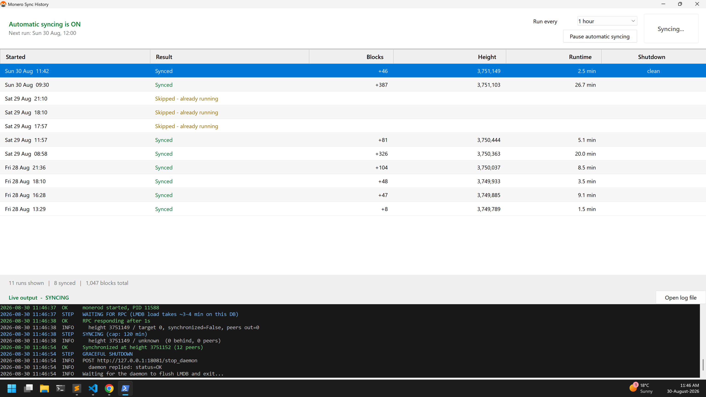

# Monero Sync Utility

**Keeps a Monero blockchain on a VeraCrypt volume up to date automatically.** It
starts `monerod` on a schedule, waits until the node is synced, then shuts it
down gracefully — so the database is never left running unattended or killed
mid-write.



> **New: single-exe desktop app.** [`app/`](app/README.md) packages these
> scripts into one Windows exe with a tray icon, a blockchain-folder picker,
> start at sign-in, and runs exactly on the hour. No Task Scheduler setup. The
> scripts below still do all the syncing.

---

## Quick start

```powershell
cd C:\Users\pc\Documents\monero-sync-utility

# 1. Install the hourly task and the login shortcut (run once)
.\Install-Task.ps1

# 2. Start the tray icon now, without logging out
wscript.exe "C:\Users\pc\Documents\monero-sync-utility\Start-Tray.vbs"
```

That is the whole setup. From then on it syncs every hour on the hour, and the
Monero icon sits in your tray.

**Left-click the tray icon** to see history, change the frequency, or hit
**Sync now**.

---

## Everyday use

Everything is in the tray icon — you should not need the command line again.

| I want to... | Do this |
|---|---|
| See what has been happening | **Left-click** the tray icon |
| Sync right now | Left-click, then **Sync now** |
| Watch a sync as it happens | Left-click — the **Live output** pane at the bottom |
| Stop a sync cleanly | **Stop sync**, above the live output. The daemon flushes and exits; you are notified when it has |
| Kill a stuck daemon | **☠ Terminate** — force-kills `monerod` *without* flushing. Confirmation required. Only if a graceful stop has already failed |
| Blank the live output | **Clear output** — empties the pane and the rolling log behind it |
| Wipe the run table | **Clear history** — deletes all history rows and files. Asks for confirmation; cannot be undone |
| Change how often it runs | Left-click, then the **Run every** dropdown |
| Stop automatic syncing for a while | Left-click, then **Pause automatic syncing** |
| Check the drive is mounted and it is safe to run | Right-click, then **Run checks now** |
| Quit the tray | Right-click, then **Exit** |

Closing the history window leaves the tray icon running. Only **Exit** quits it.

The icon is **orange** when automatic syncing is armed and **grey** when paused.

### Reading the history window

Each row is one run:

| Column | Means |
|---|---|
| **Started** | When the run began |
| **Result** | `Synced`, `Skipped - ...`, `Interrupted`, or an error |
| **Blocks** | How many blocks it pulled down |
| **Height** | Where the chain ended up |
| **Runtime** | How long the whole run took |
| **Shutdown** | `clean` if the daemon closed the database properly |

**Shutdown is the column that matters.** `clean` means the daemon logged its
full shutdown sequence — proof the database closed safely. `NOT CLEAN` means it
exited without doing so, and is worth investigating.

### Uninstalling

```powershell
.\Install-Task.ps1 -Remove
```

Removes the scheduled task and the login shortcut. It does not close a tray
icon that is already running — right-click it and choose Exit.

---

## How it works

`monerod` has no "sync then quit" mode — it syncs and then keeps running. So
this is not really a script that runs the daemon; it **supervises** one: starts
it, watches until it reports synced, then shuts it down gracefully and gets out
of the way.

### Why the care around shutdown

An LMDB database killed mid-write can be corrupted, and a 280 GB blockchain is
a long re-sync. Everything here is built around one rule:

> **`monerod` is never force-killed.** Not on timeout, not on error, not on
> cleanup. If it will not stop, it is left running and the problem is logged
> loudly.

Shutdown is always the terminal command `monerod.exe --data-dir X exit` — the
same command you would type by hand — with a timeout guard on the client (a
stuck client is killed; the daemon never is). After the daemon exits, its
log is checked for the four messages it prints on a clean shutdown:

```
Deinitializing core
Stopping cryptonote protocol
Cryptonote protocol stopped successfully
Stopping core RPC server
```

Those four appearing is the only real proof the database closed cleanly. The
history window shows `clean` or `NOT CLEAN` per run based on them.

---

### What a run does

```
1. Single-instance guard          -> exit if another run is in progress
2. Blockchain mounted?            -> exit if E:\...\lmdb\data.mdb is missing
3. VirtualBox VM running?         -> exit if one is
4. Stop any monerod already running, gracefully
5. Suppress sleep for the duration
6. Start monerod with the bare command, exactly as typed by hand
7. Poll "monerod status" until synchronized, with peers
8. Run "monerod exit", wait for a clean shutdown
9. Verify shutdown markers, record history
```

#### Preflight

**Blockchain mounted** is checked by the presence of
`E:\Monero Blockchain\lmdb\data.mdb`, not by whether `E:\` exists. VeraCrypt
volumes do not reliably appear through `Get-Volume`, and pointing `monerod` at
an empty folder would begin a fresh sync from block 0 onto unencrypted disk —
the worst failure this utility can have.

**VirtualBox** only counts actual VMs (`VBoxHeadless`, `VirtualBoxVM`).
`VBoxSVC.exe` is deliberately ignored: it lingers as a background COM service
long after everything is closed and would block runs constantly.

The VM check does not stop at preflight. For as long as `monerod` is alive —
loading, syncing, or flushing — the run checks for a VM **once a second**. If
one starts, the daemon is stopped gracefully, the run is recorded as
`Stopped - VM started`, and two desktop notifications are sent: one when the
shutdown begins, and an **all-clear** once the daemon has exited and released
the database. Do not use the VM until the all-clear arrives — the daemon can
take anywhere from seconds to several minutes to flush.

**A running `monerod` is not a reason to skip.** Every daemon found is stopped
gracefully first. This is deliberate — see *Orphaned daemons* below. It also
means a daemon you started by hand will be stopped; that is logged when it
happens.

#### Deciding when it is synced

The `status` command reporting a fully synced height is trusted **only once the
daemon has at least four peers and has been up for 45 seconds**. A freshly
started node reports its own height as the target with no connections and
claims to be synchronized, because it has nothing to compare against.

One peer is not enough to break the tie. The first peer connects within a
second or two but has not yet sent its chain data, so the node still looks
synced — runs were exiting three seconds in with `+0 blocks` while genuinely
being over a hundred blocks behind, and the next run minutes later would find
them all. Whether that happens is pure polling luck, which is why it looked
like scheduled runs and **Sync now** behaved differently; they run the same
script, and now both wait for the node to actually hear the network before
believing it.

Unanswered `status` polls during a run are normal and are not warnings:
`monerod` stops answering while it verifies and writes blocks. Only five consecutive
failures raise a warning.

---

## Orphaned daemons

The failure this design exists to prevent, and which it has already hit once.

If the supervising script dies while `monerod` is running — a crash, a logoff,
Task Scheduler stopping the task — the daemon keeps going with nothing left to
shut it down. On 29 Aug 2026 that happened: a run died mid-poll, the daemon ran
unsupervised for **5.5 hours**, blocked three scheduled runs, and was
eventually terminated with zero shutdown markers.

Three defences now:

1. **`finally` cleanup** — the script gracefully stops its daemon on essentially
   every exit path, including Ctrl+C and an unhandled error.
2. **Stop-all at startup** — any daemon found at the start of a run is stopped
   gracefully. A crash that outruns the cleanup handler (a hard kill, power
   loss) self-repairs on the next run instead of deadlocking the schedule.
3. **Battery setting** — the task no longer stops when the machine switches to
   battery. Task Scheduler "stopping" a task terminates the process without
   running cleanup, which is the most likely cause of the original incident. It
   still will not *start* a run on battery.

A run that dies before finishing still records an `INTERRUPTED` entry, so a
crash is visible in the history rather than silently missing.

---

## Files

| File | Role |
|---|---|
| `Sync-Monero.ps1` | The utility. Run by the scheduled task |
| `MoneroTray.ps1` | Tray icon and history window |
| `MoneroChecks.ps1` | Shared preflight checks |
| `MoneroDaemon.ps1` | Shared graceful-shutdown logic |
| `MoneroHistory.ps1` | Structured run history (JSON Lines) |
| `Install-Task.ps1` | Installer / uninstaller |
| `Start-Tray.vbs` | Launches the tray with no console window |

`MoneroChecks` / `MoneroDaemon` / `MoneroHistory` are dot-sourced, so the
scheduled run and the tray can never disagree about what is safe to do.

### Logs

| File | Contents |
|---|---|
| `logs\sync.log` | Supervisor timeline. Rotates at 5 MB, one `.1` backup |
| `E:\Monero Blockchain\bitmonero.log` | The daemon's own log, written and rotated by monerod itself |
| `logs\history.jsonl` | Structured history, read by the tray |
| `logs\sync-history.log` | One plain-text line per run |
| `.state\last-run.json` | Last run's outcome |

---

## Running it by hand

```powershell
.\Sync-Monero.ps1                    # full run, output to the console
.\Sync-Monero.ps1 -TestShutdownOnly  # preflight + start + graceful stop, no sync
```

Useful parameters (all have working defaults):

| Parameter | Default | Purpose |
|---|---|---|
| `-DataDir` | `E:\Monero Blockchain` | Blockchain location |
| `-MonerodPath` | `C:\Program Files\Monero GUI Wallet\monerod.exe` | Daemon binary |
| `-MaxSyncMinutes` | `120` | Cap on syncing before shutting down anyway |
| `-ShutdownTimeoutMinutes` | `40` | How long to wait for a flush before reporting it stuck |
| `-MinPeers` | `4` | Peers required before believing `synchronized` |
| `-SyncSettleSeconds` | `45` | Minimum uptime before a `synchronized` report counts |

### Exit codes

| Code | Meaning |
|---|---|
| `0` | Synced and shut down cleanly |
| `1` | Preflight failed — a normal, expected skip |
| `2` | Shut down cleanly, but did not reach full sync |
| `3` | Shutdown timed out — **daemon may still be running** |
| `4` | Daemon died unexpectedly |

---

## Current configuration

- **Every hour, on the hour**, changeable from the tray
- Runs as the logged-on user, **only when logged on** — VeraCrypt mounts `E:`
  per session, so a task running as SYSTEM or while logged off would not see
  the volume and every run would fail the mount check
- Will not start on battery; will not be killed if the machine switches to
  battery mid-run
- Overlapping runs are skipped
- 2-hour execution limit

### A note on cadence

Observed runs take 1.5–27 minutes depending on how far behind the node is. A
run that overruns its slot is caught by the single-instance guard and the next
slot skips, so hourly is safe but not guaranteed. If skips become common,
lower the frequency from the tray.

---

## Troubleshooting

**Tray icon does not appear** — a copy may already be running (single-instance
guard). Right-click any existing icon and Exit, then relaunch.

**Everything is skipping** — open the history window; the Result column names
the reason. Most often the VeraCrypt volume is not mounted.

**A run says the daemon would not stop** — do **not** kill it. It is almost
certainly still flushing; one observed shutdown took 24 minutes and completed
cleanly. Leave it; the next run will stop it before starting. To check by hand:

```powershell
& "C:\Program Files\Monero GUI Wallet\monerod.exe" --data-dir "E:\Monero Blockchain" exit
```

**A run shows `NOT CLEAN`** — the daemon exited without logging its shutdown
sequence. The database is probably fine (LMDB is resilient), but confirm the
next run opens it and reports a sane height.
